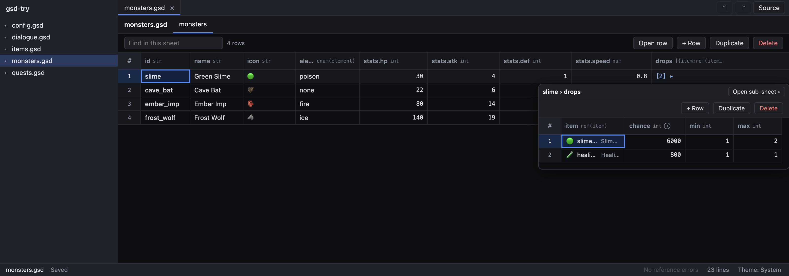

<div align="center">


# GSD

**シートの形をした、型付きで、ツリーも表せるデータ用テキスト形式。**<br>
シートのように編集し、コードのように diff し、JSON のように読む。

[English](README.md) · [한국어](README.ko.md) · **日本語** · [简体中文](README.zh-CN.md)

[](LICENSE)




<sub>GSD エディタ — <code>[…]</code>・<code>{…}</code> のセルにマウスを乗せると、中のデータがもう一枚のシートとして開く。</sub>

</div>

---

## なぜ GSD？

表データを扱う人 — ゲームプランナー、翻訳者、設定ファイルが育ちすぎた誰か — は、結局 **スプレッドシート**（編集は楽だが diff とマージが難しい）と **JSON/YAML**（プログラムには良いが、150 体のモンスター表にはつらい）のどちらかを選ぶことになる。GSD はその両方を満たす一つのテキスト形式だ。

|  | JSON | YAML | CSV | **GSD** |
|---|:---:|:---:|:---:|:---:|
| 1 行 = 1 レコード、小さな diff | ✗ | ✗ | ✓ | **✓** |
| ファイル内に列の型 | ✗ | ✗ | ✗ | **✓** |
| ネストしたオブジェクト・配列 | ✓ | ✓ | ✗ | **✓** |
| ファイル間の参照チェック | ✗ | ✗ | ✗ | **✓** |
| 1 つの値に 1 つの正規テキスト | ✗ | ✗ | ✗ | **✓** |
| シートとして開ける | ✗ | ✗ | ✓ | **✓** |

`.gsd` ファイルを読むと **JSON とまったく同じツリー**（オブジェクト・配列・文字列・数値・真偽値・null）が得られ、どんな JSON ツリーも GSD に書き戻せる。プログラムは普通の値をそのまま扱える。

## ✨ 特徴

- 🧮 **シートの形** — ブロック 1 つがシート、1 行が 1 レコード、列は `|` で揃える。
- 🏷️ **型付き** — `int`、`num`、`str`、`bool`、`[T]`、`{a:T}`、直和型、`enum(…)`、`ref(…)` をヘッダー行で宣言。
- 🌳 **ツリー** — ドット列（`stats.hp`）、子シート（`^` 列）、セル内の `[a; b]` / `{k=v}`。
- 🔗 **参照** — `@ref` で列が別ファイルのキーを指す。ツールが候補を一覧し、存在しないキーを報告する。
- 📝 **選択肢と説明がデータと一緒に** — `@enum` と `@doc` でエディタがドロップダウンとツールチップを出せる。
- 🔁 **ロスレスかつ正規形** — JSON ⇄ GSD を往復でき、整形は何度かけても同じ。
- 🖥️ **エディタ付き** — GSD をシートとして編集するデスクトップアプリと React コンポーネント。

## ちょっと見てみる

`examples/monsters.gsd` — ステータスはドット列、ドロップは子シート：

```
@ref item = items.gsd#items.id label=name icon=icon

@sheet monsters key=id
id:str     | name:str    | icon:str | element:enum(element) | stats.hp:int | stats.atk:int | stats.def:int | stats.speed:num
slime      | Green Slime | 🟢       | poison                | 30           | 4             | 1             | 0.8
cave_bat   | Cave Bat    | 🦇       | none                  | 22           | 6             | 0             | 1.6

@sheet monsters.drops
^        | item:ref(item) | chance:int | min:int | max:int
slime    | slime_gel      | 6000       | 1       | 2
cave_bat | slime_gel      | 1500       | 1       | 1
```

読み込むと

```json
{ "monsters": [
  { "id": "slime", "name": "Green Slime", "icon": "🟢", "element": "poison",
    "stats": { "hp": 30, "atk": 4, "def": 1, "speed": 0.8 },
    "drops": [ { "item": "slime_gel", "chance": 6000, "min": 1, "max": 2 } ] },
  …
] }
```

<details>
<summary><b>もっと見る：直和型・enum・説明</b>（<code>examples/quests.gsd</code>）</summary>

```
@type reward = {gold:int} | {exp:int} | {item:ref(item) count:int}
@enum goalKind = kill | collect | talk
@doc quests.rewards = Rewards granted on completion

@sheet quests key=id
id:str        | title:str     | level:int | goal:{kind:enum(goalKind) monster:ref(monster)? item:ref(item)? count:int} | rewards:[reward]
slime_trouble | Slime Trouble | 1         | {kind=kill; monster=slime; count=5}                                        | [gold 80; exp 40]
```

`[gold 80; exp 40]` は `[{gold=80}; {exp=40}]` の短縮形。`examples/dialogue.gsd` は `next` 列が `ref(node)` の会話ツリー、`examples/config.gsd` は `@props` で書いた名前付きの値。

</details>

## 🚀 はじめる

> まだ npm・crates.io には公開していない — クローンして使う。

```sh
git clone https://github.com/ljs0218/gsd.git && cd gsd
pnpm i
pnpm test

node packages/cli/gsd.mjs json examples/items.gsd          # ツリーを JSON で表示
node packages/cli/gsd.mjs convert some.json -o some.gsd     # JSON → GSD（スキーマ推定）
node packages/cli/gsd.mjs fmt examples/*.gsd --check        # すべて正規形か？
node packages/cli/gsd.mjs check examples                    # @ref のキーはすべて存在するか？
```

エディタを開く：

```sh
pnpm --filter gsd-editor dev
```

Node 22 以上が必要（CLI は TypeScript のソースを直接実行する）。

## 📖 文法早見表

| 要素 | 書き方 | 意味 |
|---|---|---|
| コメント | `# テキスト`（行全体） | 直後のブロックの上に残る |
| シート | `@sheet パス [key=列] [map] [opt]` + ヘッダー行 + 1 行 1 レコード | `パス` の配列（`map` ならオブジェクト） |
| 子シート | `@sheet 親.フィールド`、先頭列 `^` | `^` に書いた親の行の下に付く |
| プロパティ | `@props [パス]` + `キー: 型 = 値` の行 | 名前付きの値 |
| 名前付き型 | `@type 名前 = 型` | 再利用できる型。`{a:int} \| {b:str}` は直和型 |
| 列の型 | `int` `num` `str` `bool` `[T]` `{a:T b:T?}` `any` `名前` | 末尾の `?` で省略可能な列（空セル = キーなし） |
| タグ | `enum(名前)` `ref(種類)` | 文字列として読まれる。意味は下の指示子が与える |
| ドット列 | `stats.hp:int` | 形の決まったオブジェクトを展開する |
| null | `~` | どのセルでも |
| `@enum 名前 = a \| b \| c` | 指示子 | `enum(名前)` 列の選択肢 |
| `@ref 種類 = ファイル#シート.キー列 [label=列] [icon=列]` | 指示子 | `ref(種類)` 列の参照先 |
| `@doc シート.列 = テキスト` | 指示子 | 列の説明（ツールチップ） |

完全な仕様は [SPEC.md](SPEC.md)（現在は韓国語のみ）。すべての実装が共通で通す適合サンプルは [`fixtures/`](fixtures) にある。

## 📦 パッケージ

| パッケージ | 言語 | 役割 |
|---|---|---|
| [`@gsd/core`](packages/core) | TypeScript | 読み込み、正規形での書き出し、JSON からのスキーマ推定、ワークスペース API（`loadWorkspace`、`refOptions`、`enumOptions`、`checkRefs`） |
| [`@gsd/cli`](packages/cli) | TypeScript | `gsd convert` · `gsd fmt` · `gsd json` · `gsd check` |
| [`@gsd/sheet`](packages/sheet) | React | `<GsdBook>` — 1 ファイルをタブ付きシートで編集し、ネストはポップオーバーで、正規形テキストを出力 |
| [`gsd`](packages/rust) | Rust | 読み込み：`gsd::parse(text)` → `serde_json::Value`、`gsd::from_str::<T>(text)` |
| [`gsd.lua`](packages/lua) | Lua 5.1 / LuaJIT | 読み込み：`gsd.decode(text)` → JSON リーダーと同じツリー |
| [GSD エディタ](apps/editor) | Electron | デスクトップアプリ：ファイル・フォルダを開く、シートで編集、元に戻す、保存、参照チェック |

```tsx
import { GsdBook } from "@gsd/sheet";
import "@gsd/sheet/style.css";

<GsdBook path="items.gsd" text={text} onChange={setText}
         refs={(kind) => refOptions(ws, "items.gsd", kind)} theme="dark" />
```

## 🗺️ ロードマップ

- [x] 仕様、正規形ライター、JSON ⇄ GSD 往復
- [x] TypeScript・Rust・Lua のリーダーが同じサンプルを通過
- [x] `@enum`・`@ref`・`@doc` 指示子とワークスペースの参照チェック
- [x] `@gsd/sheet` コンポーネントと GSD エディタ（開発ビルド）
- [ ] 英語版の仕様
- [ ] macOS・Windows・Linux 向けエディタのパッケージ
- [ ] npm・crates.io への公開
- [ ] VS Code のシンタックスハイライト

## 🤝 コントリビュート

Issue と PR を歓迎します。送る前に：

```sh
pnpm test && pnpm typecheck
(cd packages/rust && cargo test)
(cd packages/lua && luajit test.lua)
```

形式を変える場合は、すべてのリーダーが通るサンプルを [`fixtures/`](fixtures) に追加してください。

## ライセンス

[MIT](LICENSE)
